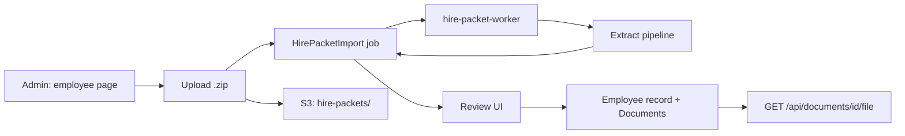

# Hire packet import (v1) — design spec

**Date:** 2026-08-24  
**Status:** Draft — pending user approval  
**Product:** ACT Persona / ACT ERP (`act-erp-ai/apps/web`)

## Goal

Let HR upload a **zip of onboarding documents for one existing employee**, extract structured profile fields with minimal manual entry, let HR **review and check** what to apply, store every file as a normal **employee document** (employee can download), without touching the AI knowledge base.

## Locked decisions (from brainstorming)

| Decision | Choice |
|---|---|
| Scope | **C** — onboarding forms first (v1), generic HR dump later (v2) |
| Entry point | **A** — from an **existing** employee record |
| Text extraction | **B** — digital PDF text first; **Textract** only when text is thin/empty |
| Apply behavior | **B** — HR **checks each field**; only selected fields write to `Employee` |
| Processing | **A** — **background job** with status UI (not synchronous) |
| Field intelligence | **C** — **templates** for known forms; **LLM** for gaps / low confidence |

## Approaches considered

### 1. All-in Next.js server action (sync) — rejected

Upload zip → extract in the same request → return review payload.

- **Pros:** Simplest code, no worker.
- **Cons:** Textract + multi-PDF zips exceed server timeouts on Lightsail; bad UX for HR waiting on a spinner.

### 2. Reuse AI ingestion worker (Python/SQS) — rejected for v1

Route hire zips through `apps/ai` Marker/Textract pipeline.

- **Pros:** Worker already exists on full ECS deploy.
- **Cons:** Not on prod-lite; wrong abstraction (RAG chunks vs HR field mapping); couples HR to `KnowledgeDocument`.

### 3. Dedicated hire-packet job + lightweight worker — **recommended**

New `HirePacketImport` job in Postgres; zip → S3; Node worker processes queue; admin review UI in web app.

- **Pros:** Works on **Lightsail prod-lite** (extra compose service, same web image); clear boundaries; same pattern as paystub parsing + future v2 general import.
- **Cons:** One more container/process to run and monitor.

## Architecture (recommended)

### Components

| Unit | Responsibility |
|---|---|
| **`HirePacketImport` (Prisma)** | Job state, proposed fields JSON, per-file results, errors |
| **Upload UI** | Admin on `/admin/employees/[id]` — zip only, size/file caps |
| **`hire-packet-worker`** | Polls `PENDING` jobs, runs pipeline, marks `READY` or `FAILED` |
| **`lib/hire-packet/extract/`** | Unzip, text extraction, classification, templates, LLM merge |
| **Review page** | `/admin/employees/[id]/hire-import/[jobId]` — grouped fields + checkboxes |
| **`applyHirePacketImport`** | Writes checked fields via existing `updateEmployee`; documents already stored |
| **Existing `Document` + file route** | Employee download — no new download path |

### Job statuses

`UPLOADING` → `PENDING` → `PROCESSING` → `READY` | `FAILED` | `APPLIED` | `CANCELLED`

HR can open review at `READY`. `APPLIED` after successful apply (audit trail).

## Extraction pipeline (per file in zip)

1. **Validate zip** — max size (e.g. 50 MB), max files (e.g. 30), allowed extensions: `.pdf`, `.jpg`, `.jpeg`, `.png`.
2. **Unzip** to temp; ignore `__MACOSX`, hidden paths.
3. **Text layer**
   - PDF: `pdftotext` (Poppler in Docker) or pdf.js text extraction (same family as paystub parser).
   - Images: skip straight to Textract.
4. **OCR fallback** — if extracted text length &lt; threshold (e.g. 200 chars), call **AWS Textract** `DetectDocumentText`.
5. **Classify** — heuristic title/content match: `I9`, `W4`, `DRIVERS_LICENSE`, `DIRECT_DEPOSIT`, `OFFER_LETTER`, `UNKNOWN`.
6. **Template extractors (v1)** — deterministic parsers per class (like `paystub-parser.ts`):
   - Name, address (street/city/state/zip), phone, email, DOB, **SSN last 4 only**, emergency contact, job title, date of hire, marital status hints.
7. **LLM merge (gaps only)** — send combined text + current proposals + target JSON schema; fill fields still empty or confidence &lt; threshold. Use Gemini when configured; optional Bedrock on full AWS. **If no LLM:** leave field blank for HR.
8. **Persist file** — create `Document` row (`documentType: ONBOARDING` or inferred), `employeeId` = target employee, S3 key under `{employeeId}/hire-import/{jobId}/...`.
9. **Record per-file metadata** on job: `{ fileName, documentId, formType, textSource: digital|textract, warnings[] }`.

### Security / compliance

- **Never store full SSN** — extract at most last 4; discard full match in logs.
- Do not send full SSN to LLM; redact `###-##-####` patterns in prompts.
- Textract + S3 scoped IAM user (already on Lightsail for documents).
- Audit: `hire_packet.import`, `hire_packet.apply`.

## Review UI (HR)

**Route:** `/admin/employees/[id]/hire-import/[jobId]`

While `PROCESSING`: progress + file list as they complete.

When `READY`:

- **Left:** proposed fields grouped like employee tabs — **Personal**, **Work**, **Identity** (v1). Compensation only if offer letter parsed with confidence (optional v1.1).
- Each row: label, **proposed value**, **current value**, source file, confidence badge, **checkbox** (default on if field empty + confidence ≥ medium).
- **Right or bottom:** list of imported files with link to preview/download.
- Actions: **Apply selected**, **Discard import** (keep documents? default: keep docs, discard proposals), **Re-run extraction** (v1.1).

Apply calls existing `updateEmployee` with only checked fields; sets job `APPLIED`.

## Employee download

No new feature — imported files are normal `Document` rows. Employee sees them under **Dashboard → Documents** (ONBOARDING tab). Download via existing authenticated `/api/documents/[id]/file`.

**Fix required (separate from import):** today employee doc list includes all `COMPANY|BENEFITS|TRAINING` docs globally — tighten to **this employee’s rows only** so hire packets stay private.

## v1 form set (onboarding packet)

| Form | Extract (v1) |
|---|---|
| I-9 | Name, address, DOB, SSN last 4, phone |
| W-4 | Name, address, marital status (if clear) |
| Driver's license / state ID | Name, address, DOB |
| Direct deposit | Store document; **do not** auto-fill bank numbers (no columns; PCI-ish) |
| Offer letter | Job title, date of hire, compensation hints (review only) |

## Deployment (Lightsail prod-lite)

- Add **`hire-packet-worker`** service to `docker-compose.prod-lite.yml` — same `web` image, command `node scripts/hire-packet-worker.js` (or tsx).
- Dockerfile: install **`poppler-utils`** (`pdftotext`).
- Env: existing `AWS_*` for S3 + Textract; optional `GEMINI_API_KEY` / Bedrock for LLM step.

Full ECS: same worker container or later SQS — interface unchanged (job table is source of truth).

## Out of scope (v1)

- Zip-first employee creation (no employee yet).
- Multi-employee zip routing.
- Auto-apply without review.
- Knowledge base / RAG indexing of hire docs.
- Bank account fields on employee profile.
- v2 “generic HR dump” classification.

## Testing

- Unit: template parsers with fixture PDF text snippets; `formatMoneyInput`-style edge cases for dates/phones.
- Integration: zip with 2 PDFs → job `READY` → apply selected fields → employee + documents updated.
- Manual: scanned I-9 triggers Textract path; clean W-4 does not.

## Success criteria

- HR uploads onboarding zip on employee page, gets review in &lt; 2 min for typical 5–10 PDF packet on Lightsail.
- ≥ 80% of empty standard fields prefilled on **digital** government forms (measured on seed fixtures).
- Employee can download every imported file from Documents.
- No full SSN in DB, logs, or LLM prompts.
